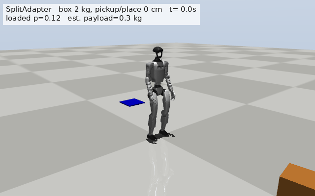
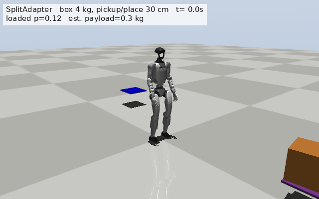
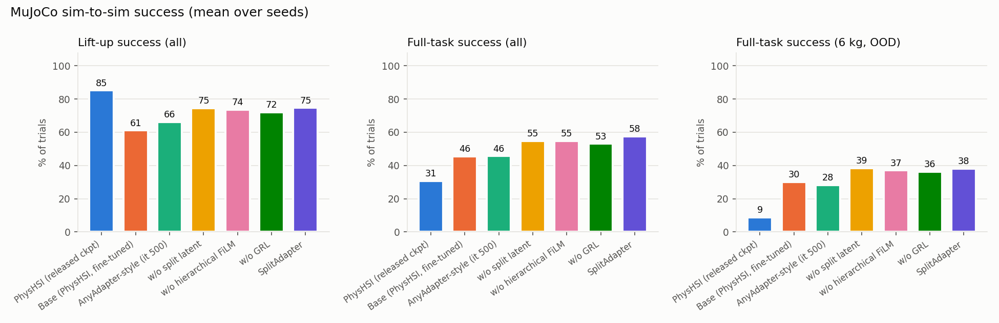
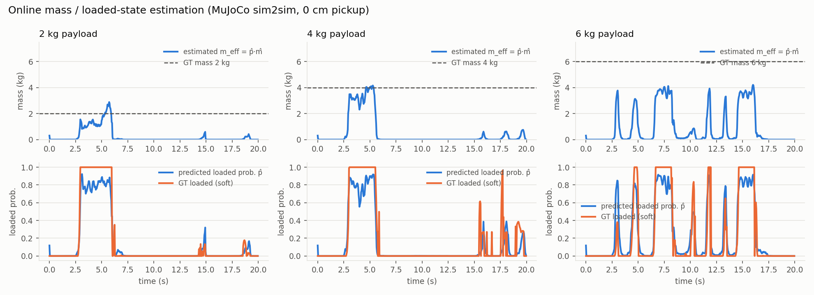

# SplitAdapter-Reproduced

An unofficial reproduction of **SplitAdapter: Load-Aware Humanoid Loco-Manipulation via Factorized Adaptation**
(Kang, Cho, Kang, Koo, 2026) for Unitree G1 box carrying, in simulation.

📄 Paper: [arXiv:2606.03297](https://arxiv.org/abs/2606.03297) · 🌐 Project page: [splitadapter.github.io](https://splitadapter.github.io/)

This repository is not affiliated with the authors. It re-implements the method from the paper's text
and appendix, trains it in Isaac Gym on top of a frozen [PhysHSI](https://github.com/InternRobotics/PhysHSI)
carry-box policy, and evaluates it in MuJoCo sim-to-sim following the paper's protocol. Real-robot experiments are
not reproduced.

<p align="center">
  
  
  <br><em>SplitAdapter in MuJoCo sim-to-sim (policy trained in Isaac Gym). The overlay shows the adapter's online
  loaded-state probability and payload estimate.</em>
</p>

## Summary

What we could reproduce, in simulation (MuJoCo sim-to-sim, 3 training seeds × 3 evaluation seeds per method):

* **SplitAdapter improves the frozen base policy** — Full-task success 41.0 → **51.8 / 90** in MuJoCo
  (25.0 → 33.0 in Isaac Gym), with Lift-up success 55.0 → 67.2.
* **A unified-latent world-model FiLM adapter (AnyAdapter-style) does not improve the base** (41.1 / 90), while
  SplitAdapter does (difference +10.7, Welch p = 0.05 in MuJoCo, p = 0.02 in Isaac Gym).
* **The full model ranks first among the ablations** in both simulators; removing the split latent, GRL or
  hierarchical FiLM lowers the success rate slightly (pooled over the three ablations: −3.0 in MuJoCo,
  −4.9 in Isaac Gym).
* **Online mass and loaded-state estimation works**: the loaded probability switches within ~0.3 s of lifting and
  the payload estimate tracks the box mass inside the training range.
* **Split world models reach lower transition-prediction errors** than a single unified world model.

Our absolute success rates are lower than those reported in the paper (we use a different base policy and a
shorter training budget, see [Differences from the paper](#differences-from-the-paper)), and with 3 seeds the
differences between the individual ablations are within seed variance.

## Results

Evaluation grid of the paper: box mass {2, 4, 6} kg × pickup/placement height {0, 30, 60} cm, 10 trials per
condition (90 per evaluation). 6 kg is outside the training range (0.5–5 kg). *Full-task* = approach, lift,
transport and place the box within 0.1 m of the goal; *Lift-up* = box held off its support for 0.5 s.

### MuJoCo sim-to-sim (mean over 3 training seeds × 3 evaluation seeds)

Full-task successes per condition (out of 10) and totals (out of 90):

| Method | 2kg 0 | 2kg 30 | 2kg 60 | 4kg 0 | 4kg 30 | 4kg 60 | 6kg 0 | 6kg 30 | 6kg 60 | **Full-task** | Lift-up |
|---|---|---|---|---|---|---|---|---|---|---|---|
| PhysHSI (released ckpt) | 6.0 | 7.3 | 0.7 | 4.0 | 6.7 | 0.3 | 1.0 | 1.7 | 0.0 | 27.7 ± 4.5 | 76.7 |
| Base (PhysHSI, fine-tuned) | 7.3 | 9.7 | 2.0 | 3.3 | 9.0 | 0.7 | 0.3 | 7.3 | 1.3 | 41.0 ± 1.4 | 55.0 |
| AnyAdapter-style WM-FiLM ¹ | 5.9 | 9.6 | 3.1 | 3.4 | 9.0 | 1.7 | 0.4 | 7.0 | 1.0 | 41.1 ± 5.8 | 59.6 |
| w/o split latent | 8.7 | 9.9 | 2.9 | 4.3 | 9.2 | 2.7 | 1.6 | 7.7 | 2.3 | 49.2 ± 2.7 | 67.1 |
| w/o hierarchical FiLM | 8.9 | 9.9 | 2.7 | 5.7 | 9.1 | 1.9 | 1.9 | 7.3 | 1.9 | 49.2 ± 4.1 | 66.2 |
| w/o GRL | 8.7 | 9.7 | 2.2 | 4.7 | 9.2 | 2.4 | 1.7 | 7.7 | 1.6 | 47.8 ± 3.3 | 64.9 |
| **SplitAdapter** | 9.0 | 9.9 | 3.0 | 6.3 | 9.6 | 2.6 | 1.6 | 7.7 | 2.2 | **51.8 ± 3.8** | **67.2** |

¹ evaluated at training iteration 500; with the same hyper-parameters its training diverges later on.

### Summary across both simulators

| Method | MuJoCo Full-task / 90 | Isaac Gym Full-task / 90 | Paper (MuJoCo) Full-task / 90 |
|---|---|---|---|
| Base | 41.0 | 25.0 | 71 |
| AnyAdapter-style WM-FiLM | 41.1 | 23.3 | 75 |
| w/o split latent | 49.2 | 27.7 | 81 |
| w/o hierarchical FiLM | 49.2 | 28.0 | 81 |
| w/o GRL | 47.8 | 28.7 | 84 |
| **SplitAdapter** | **51.8** | **33.0** | **86** |

Isaac Gym numbers are with the training-time domain randomisation and are noisier (repeated evaluations of the
same policy vary by about ±5 / 90). Per-condition tables, Lift-up results and the latent analysis are in
[`results/REPORT_TABLES.md`](results/REPORT_TABLES.md); raw per-run results are in `results/*.json`.

<p align="center">
  
</p>

### Online mass / loaded-state estimation (cf. paper Fig. 4)

<p align="center"></p>

### World-model transition losses (cf. paper Fig. 5a)

| Variant | object WM L1 | robot WM L1 |
|---|---|---|
| AnyAdapter-style (unified latent, one WM) | 0.141 | 0.0250 |
| w/o split latent (unified latent, one WM) | 0.141 | 0.0250 |
| SplitAdapter (split latents, split WMs) | **0.135** | **0.0220** |

More figures: [`results/figs/`](results/figs) (Isaac Gym success, 6 kg box trajectories, t-SNE of the latents).

## What is implemented

| Paper component | Implementation |
|---|---|
| Frozen AMP base policy (MLP [512, 256, 256], 29-D PD targets) | PhysHSI carry-box actor, fine-tuned on the paper's task distribution, then frozen (`FrozenBasePolicy`) |
| 50-step history of 123-D observations | `splitadapter/envs/carrybox_split.py` |
| Shared Conv1d history encoder (→ 320-D) | `SharedHistoryEncoder` |
| Object/load branch: z_obj, mass m̂, loaded ℓ̂, m_eff = ℓ̂·m̂ | `SplitAdapterModel` (task head) |
| Dynamics branch: z_dyn | `SplitAdapterModel` |
| Split world models (object delta transition / 79-D robot transition) | `obj_wm`, `dyn_wm` |
| GRL cross-adversarial separation | `adv_obj_from_dyn`, `adv_robot_from_obj`, `grl()` |
| Hierarchical FiLM (object/load → early layers, dynamics → late layers) | `FiLMHead`, zero-initialised (identity at start) |
| Losses and weights of Table 6, hyper-parameters of Table 4, DR of Table 3 | `splitadapter/envs/carrybox_split_config.py` |
| Adapter trained with the base policy's RL objective | PPO + AMP (`splitadapter/algo/adapter_ppo.py`) |
| Baselines / ablations of Table 1 | `--variant anyadapter / no_split / no_hier_film / no_grl` |
| MuJoCo sim-to-sim evaluation | `sim2sim/` (same observations, noise and camera/tag perception model as PhysHSI) |

## Installation

Requirements: Linux, an NVIDIA GPU (≥ 24 GB for 4096 environments), Python 3.8 (Isaac Gym Preview 4).

```bash
conda create -n splitadapter python=3.8 -y && conda activate splitadapter
# PyTorch -- Ampere / Ada / Hopper GPUs:
pip install torch==2.0.1 --index-url https://download.pytorch.org/whl/cu118
# PyTorch -- Blackwell GPUs (sm_120): the conda-forge build ships compute_90 PTX that the driver JIT-compiles
#   conda install -c conda-forge "pytorch=2.4.0=cuda120_py38*"
#   (and if gymtorch fails to link: ln -s $CONDA_PREFIX/lib/libtorch_python.so \
#        $CONDA_PREFIX/lib/python3.8/site-packages/torch/lib/)

# Isaac Gym Preview 4: download from https://developer.nvidia.com/isaac-gym and extract to third_party/isaacgym
bash scripts/setup_third_party.sh        # clones PhysHSI (pinned commit), installs everything
export LD_LIBRARY_PATH=$CONDA_PREFIX/lib:$LD_LIBRARY_PATH
python tests/test_variants.py            # quick CPU check of all adapter variants
```

## Pretrained weights

The weights used for the results above are attached to the
[v1.0 release](https://github.com/wjh-666666/SplitAdapter-Reproduced/releases/tag/v1.0) (inference only):

| File | Content |
|---|---|
| `base_g1_carrybox_finetuned.pt` | frozen base policy (PhysHSI carry-box policy fine-tuned on the paper's task distribution) |
| `splitadapter_g1_carrybox_s{1,2,3}.pt` | SplitAdapter, training seeds 1–3 (to be used with the base policy above) |

```bash
mkdir -p weights && cd weights
for f in base_g1_carrybox_finetuned.pt splitadapter_g1_carrybox_s1.pt splitadapter_g1_carrybox_s2.pt \
         splitadapter_g1_carrybox_s3.pt SHA256SUMS; do
  wget -q https://github.com/wjh-666666/SplitAdapter-Reproduced/releases/download/v1.0/$f
done
sha256sum -c SHA256SUMS && cd ..

# MuJoCo sim-to-sim evaluation and rendering with the released weights
python sim2sim/eval_mujoco.py --ckpt weights/splitadapter_g1_carrybox_s1.pt \
    --base weights/base_g1_carrybox_finetuned.pt --trials 10 --seed 0
MUJOCO_GL=egl python sim2sim/render_video.py --ckpt weights/splitadapter_g1_carrybox_s1.pt \
    --base weights/base_g1_carrybox_finetuned.pt --mass 4 --height 0.3 --find_success 20 --out media/episode.gif
# the frozen base alone
python sim2sim/eval_mujoco.py --ckpt base --base weights/base_g1_carrybox_finetuned.pt --trials 10
```

MuJoCo evaluation only needs `third_party/PhysHSI` (for the G1 model); Isaac Gym is not required.

## Usage

```bash
# 1. fine-tune the released PhysHSI policy on the paper's task distribution (base policy)
CUDA_VISIBLE_DEVICES=0 python scripts/train_base.py --seed 1 --log_root logs/base_s1 --iters 1500 --headless

# 2. train an adapter on the frozen base (variants: split | anyadapter | no_split | no_hier_film | no_grl)
CUDA_VISIBLE_DEVICES=0 python scripts/train_adapter.py --variant split --seed 1 --iters 1500 \
    --base logs/base_s1/<run>/model_1499.pt --log_dir logs/adapter_split_s1 --headless

# 3. evaluate (mass x height grid, Lift-up / Full-task)
python scripts/eval_isaac.py  --ckpt logs/adapter_split_s1/model_last.pt --tag split_s1 --trials 10 --headless
python sim2sim/eval_mujoco.py --ckpt logs/adapter_split_s1/model_last.pt --tag split_s1 --seed 0 --trials 10

# 4. render a MuJoCo episode
MUJOCO_GL=egl python sim2sim/render_video.py --ckpt logs/adapter_split_s1/model_last.pt \
    --mass 4 --height 0.3 --find_success 20 --out media/episode.gif

# everything (3 base seeds -> base selection -> 5 methods x 3 seeds -> evaluations) on 8 GPUs:
nohup python scripts/scheduler.py --gpus 0,1,2,3,4,5,6,7 > logs/scheduler.log 2>&1 &
python scripts/compile_results.py        # tables (results/REPORT_TABLES.md) and figures (results/figs/)
```

Training a model resumes from its latest checkpoint with `--resume_adapter` (adapter) or `--init` + `--start_iter`
(base); checkpoints are written every 10 iterations. On one RTX 6000D, 4096 environments run at ~30k steps/s, so a
1500-iteration adapter takes about 5.5 h. Isaac Gym Preview 4 occasionally segfaults on recent GPUs; the scheduler
relaunches crashed jobs from their last checkpoint.

## Repository structure

```
splitadapter/
  envs/carrybox_split.py          PhysHSI G1 carry-box env + adapter history, world-model targets, mass/loaded
                                  labels, task / DR ranges of the paper, evaluation scenarios
  envs/carrybox_split_config.py   configuration (paper Tables 3-6)
  modules/split_adapter.py        frozen base, history encoder, branches, split world models, GRL, FiLM, variants
  algo/adapter_ppo.py             PPO + AMP + auxiliary objectives
scripts/
  train_base.py  train_adapter.py  eval_isaac.py  analyze_latents.py  compile_results.py  scheduler.py
  setup_third_party.sh  read_tb.py
sim2sim/
  mujoco_carrybox.py  eval_mujoco.py  render_video.py
tests/                            unit tests (variants, history windows)
results/                          evaluation results, REPORT_TABLES.md, figures
media/                            rendered episodes
```

## Differences from the paper

* **Base policy.** The authors train their own PhysHSI-style base with additional reward terms. We start from the
  released PhysHSI carry-box checkpoint and fine-tune it for 1500 iterations on the paper's task distribution
  (pickup/placement 0–0.6 m, box mass 0.5–5 kg, box size 0.25–0.45 m, Table 3 randomisation); out of three
  fine-tuning seeds, the one with the best Isaac Gym score is used.
* **Training budget.** 1500 adapter iterations (4096 environments × 100 steps); the paper does not report it.
* **Encoder gradients.** The history encoder is trained by the auxiliary objectives only (world models,
  mass / loaded supervision, GRL); the RL objective updates the FiLM generators.
* **Details not specified in the paper** (our choices): object transition target = box linear/angular velocity in
  the pelvis frame; robot transition target = 79-D noise-free next state; loaded label = box above its support and
  in hand contact; KL regulariser implemented as ½‖z‖²; per-layer FiLM assignment as drawn in Fig. 2.
* **Evaluation.** MuJoCo scene built from the same URDF, PhysHSI observation noise and tag-visibility model,
  validation box 0.30 × 0.43 × 0.30 m, goals 2.5–4 m away. The head-height fall criterion is 0.45 m during
  evaluation (0.6 m during training), because the floor pickup squat reaches ~0.62 m.
* Real-robot experiments are not reproduced.

## Acknowledgements

This work builds on [PhysHSI](https://github.com/InternRobotics/PhysHSI) (environment, AMP data and the released
carry-box policy), [Isaac Gym](https://developer.nvidia.com/isaac-gym), [MuJoCo](https://mujoco.org) and
[rsl_rl](https://github.com/leggedrobotics/rsl_rl). All credit for the method goes to the authors of SplitAdapter.
PhysHSI is released under CC BY-NC-SA 4.0; please respect its license when using this code.

## Citation

If you find this reproduction useful, please cite the original paper:

```bibtex
@article{kang2026splitadapter,
  title   = {SplitAdapter: Load-Aware Humanoid Loco-Manipulation via Factorized Adaptation},
  author  = {Kang, Jeonguk and Cho, Hanbyel and Kang, Sanghyun and Koo, Donghan},
  journal = {arXiv preprint arXiv:2606.03297},
  year    = {2026}
}
```
